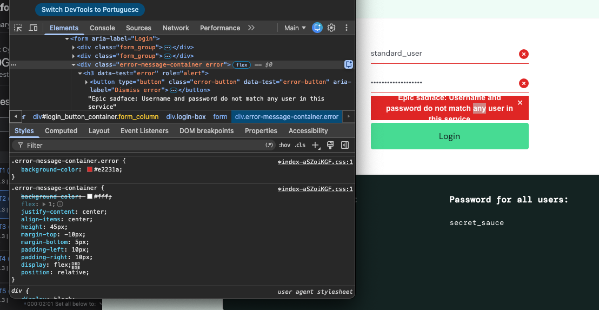
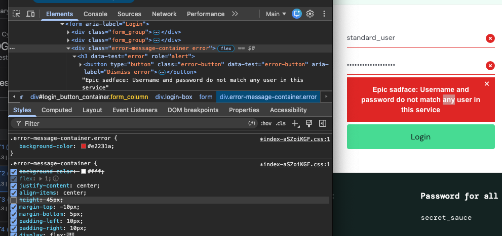
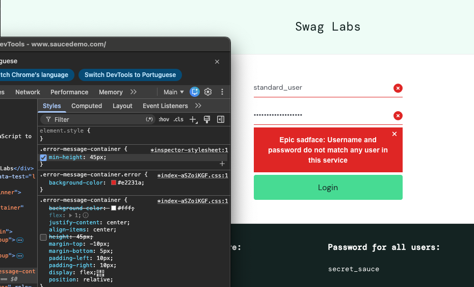
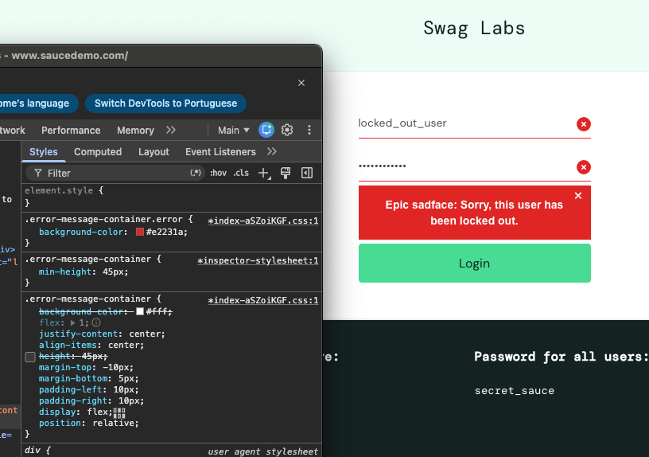
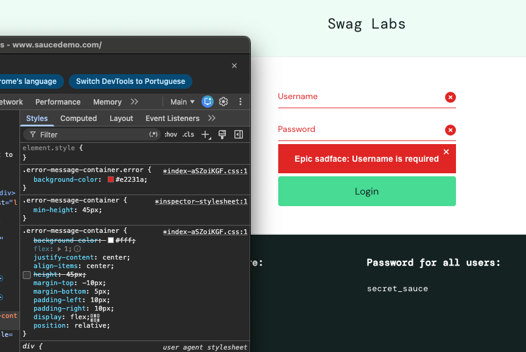

# QASD-8 | Mensagem de erro parcialmente cortada

## 1. Identificação

| Informação | Identificação |
|---|---|
| Funcionalidade | Login |
| Tipo de defeito | Interface / Legibilidade |
| Severidade | Baixa |
| Prioridade | Média |
| Situação | Aberto |
| Data de identificação | 12/11/2026 |
| Caso de teste | QASD-T2 |
| Ciclo de execução | QASD-R1 |

## 2. Descrição

Durante uma tentativa de autenticação com senha incorreta, a mensagem de erro é parcialmente cortada nas extremidades superior e inferior do componente, comprometendo sua legibilidade.

A validação funcional das credenciais ocorre conforme o esperado.

## 3. Ambiente

- Aplicação: https://www.saucedemo.com/
- Sistema operacional: macOS Sequoia 15.8.3.
- Navegador: Google Chrome 157.0.8103.78.
- Viewport: 1285 × 881 pixels CSS.
- Modo de navegação: anônimo.

## 4. Reprodução

**Pré-condição:** usuário não autenticado, com a página de login disponível.

1. Acessar a página de login.
2. Informar `standard_user` e uma senha incorreta.
3. Clicar em Login.

**Resultado esperado:** autenticação impedida e mensagem de erro integralmente visível.

**Resultado obtido:** autenticação impedida, porém com a mensagem de erro parcialmente cortada.

O comportamento foi reproduzido durante a execução formal e em uma investigação direcionada.

## 5. Investigação técnica

### 5.1. Identificação da propriedade CSS

A inspeção do componente `.error-message-container` pelo Chrome DevTools identificou uma altura fixa de 45 pixels.

```css
height: 45px;
```

Nas condições testadas, essa altura é insuficiente para acomodar a mensagem distribuída em três linhas.



### 5.2. Isolamento da causa

A propriedade `height` foi desativada temporariamente pelo DevTools, mantendo as demais propriedades.

A mensagem passou a ser exibida integralmente, sustentando a hipótese de que a altura fixa contribui diretamente para o defeito.



### 5.3. Proposta de correção

Substituir a altura fixa por uma altura mínima:

```css
min-height: 45px;
```

Essa abordagem permite que o componente se expanda conforme o conteúdo, preservando uma altura mínima.



## 6. Validação experimental

A alteração proposta foi avaliada em três cenários para verificar possíveis efeitos sobre mensagens de diferentes comprimentos.

| Cenário | CSS original | CSS modificado |
|---|---|---|
| Credenciais inválidas | Texto cortado | Texto integral |
| Usuário bloqueado | Texto integral | Texto integral |
| Campos vazios | Texto integral | Texto integral |

### Usuário bloqueado



### Campos vazios



Não foram observados novos problemas de legibilidade nos cenários avaliados.

## 7. Impacto e limitações

O defeito compromete a apresentação da mensagem de erro, mas não impede o funcionamento da autenticação.

A investigação foi realizada em um único ambiente desktop. A abrangência do problema em outras dimensões de viewport, navegadores e dispositivos não foi determinada.

A alteração CSS foi exclusivamente experimental, realizada pelo DevTools. Não houve modificação no código-fonte da aplicação.

O defeito permanece aberto, aguardando eventual implementação da correção e reteste.

## 8. Rastreabilidade

| Artefato | Identificação |
|---|---|
| História de usuário | QASD-4 |
| Requisito | LOGIN-RF-02 |
| Observação exploratória | LOGIN-OBS-01 |
| Caso de teste | QASD-T2 |
| Ciclo de execução | QASD-R1 |
| Defeito | QASD-8 |

### Referências

- [Requisitos de login](../requisitos-login.md)
- [Relatório de encerramento do ciclo](../relatorio-ciclo-login.md)
- [Registro do defeito no Jira](https://leesaeny.atlassian.net/browse/QASD-8)